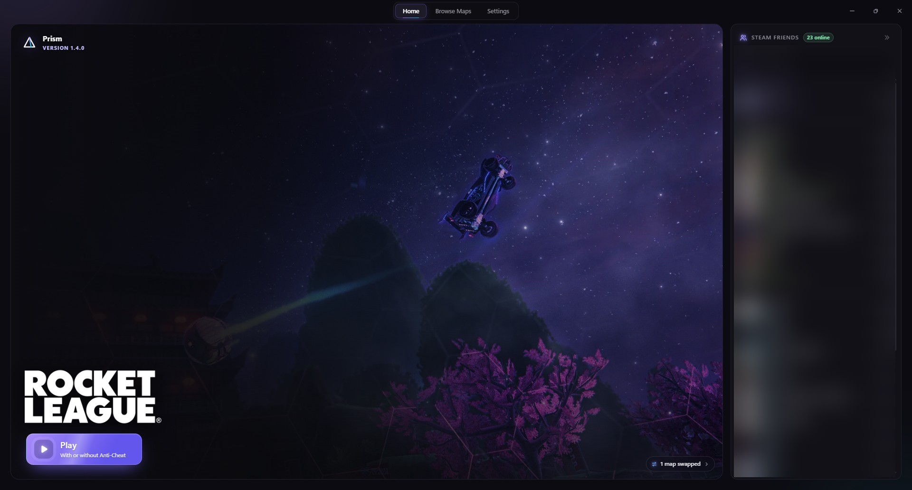
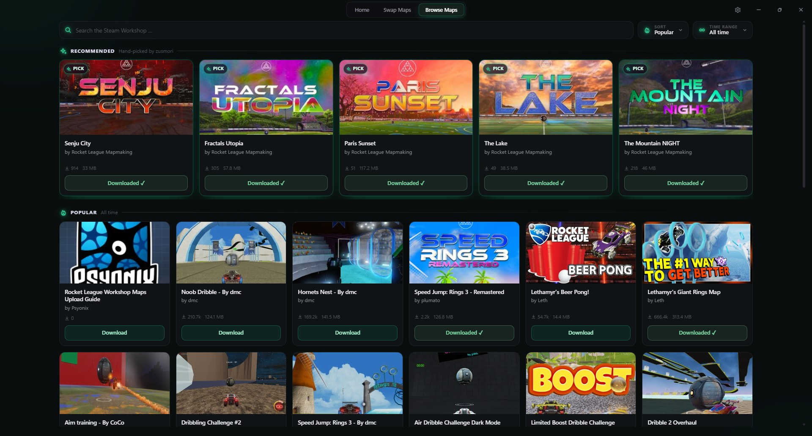

  

<h1 align="center">ZLauncher</h1>

<b>zusmori's Launcher</b> · a Rocket League launcher for Windows

  <a href="../../releases/latest"><b>⬇ Download the latest version</b></a>

  

## Features

- **Play** – start Rocket League with Anti-Cheat (online) or without (Freeplay and workshop maps).
- **Friends** – see which Steam friends are online or in a game, live.
- **Swap Maps** – play any workshop map in Freeplay. **Restore** puts the original arena back.
- **Browse Maps** – find and download workshop maps right in the app.
- **Item menu (beta)** – press **F8** in Rocket League to use any item in Freeplay and offline. Only you can see them, only without Anti-Cheat.
- **Game Boost** – more performance while you play, reset when the game closes.
- **Discord** – shows your mode and score on your profile, e.g. *2s Ranked · 2 : 1*.
- 4 colors with video backgrounds, close to tray, automatic updates.

  

## Getting started

1. [Download](../../releases/latest) `ZLauncher.exe` and run it. No install needed.
2. If Windows warns you, click **More info → Run anyway**.
3. Make sure Steam is running and hit **Play**.

## Good to know

- Workshop maps only work offline and **without Anti-Cheat**.
- Needs Windows 10/11 and Rocket League on Steam.
- Unofficial fan project, not affiliated with Psyonix, Epic Games, Valve or Discord. Use at your own risk.

Questions or bugs? Discord: **zusmori**
