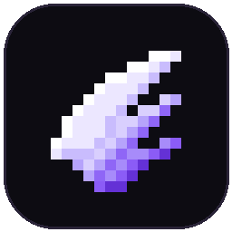
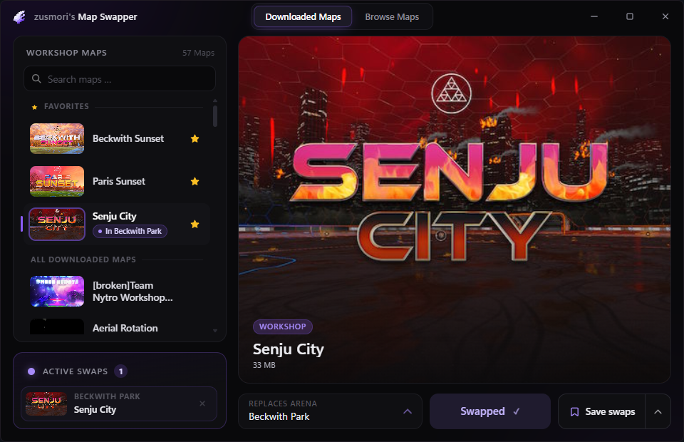

  

<h1 align="center">zusmori's Map Swapper</h1>

<b>ZMS</b>

Play workshop maps in Rocket League Freeplay. Pick one, hit swap, done.

  <a href="../../releases/latest"><b>Download</b></a>

  

## How it works

1. Download a map in **Browse Maps** (or subscribe to one in the Steam Workshop)
2. Pick it in **Downloaded Maps**. Rocket League can stay open, just stay in the main menu
3. Choose the arena it should replace and hit **Swap**
4. Start Freeplay on that arena. Rocket League has to run **without Easy Anti-Cheat**

Done playing? Hit **Restore** and everything's back to normal.

## Good to know

- **Offline only** (Freeplay, training, LAN). Psyonix [allows third-party mods in offline modes](https://www.rocketleague.com/news/easy-anti-cheat-comes-to-rocket-league-on-pc-today) as long as you launch the game **without Easy Anti-Cheat**. ZMS won't touch any files while Anti-Cheat is running.
- Always **Restore** before going online or into ranked. If in doubt, verify your game files in Steam.
- ZMS only swaps map files on your own PC and puts the originals back. It doesn't change the game itself, give you items or touch online play.
- Workshop maps belong to their creators. ZMS downloads them through your own Steam account, the same way subscribing in the Workshop does.
- Windows might warn you on first launch since the app isn't signed. Click **More info → Run anyway**.
- Works with Beckwith Park, Farmstead, Salty Shores, Underpass, Utopia Coliseum and Wasteland.
- Needs Windows 10/11 and Rocket League on Steam.

## Disclaimer

Unofficial fan project. Not affiliated with, endorsed or sponsored by Psyonix, Epic Games or Valve. Rocket League, Steam and all related names are trademarks of their respective owners. Use at your own risk.

## Support

Stuck or found a bug? Message me on Discord: **zusmori**
