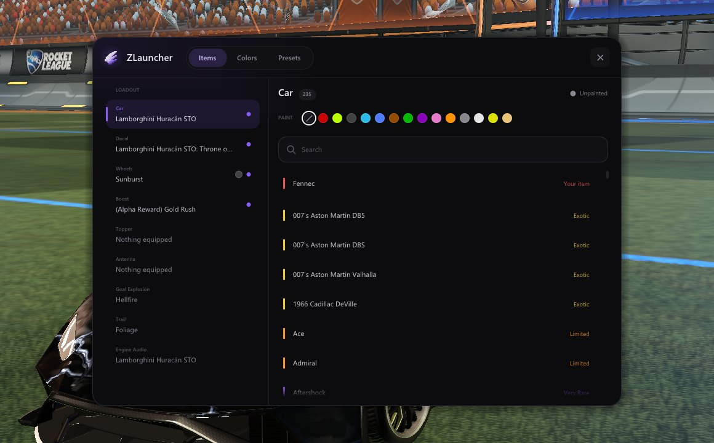

  

<h1 align="center">Prism</h1>

A clean Rocket League launcher for Windows.

  <a href="../../releases/latest"><b>⬇ Download</b></a>

  

## What it does

- **Swap items**: use any item in game, painted versions included. Only you can see them.
- **Custom decals & balls**: drop your own decal or ball pack into the Customs folder and use it in game.
- **Presets**: save your whole loadout, custom decal and ball included, and switch with one click.
- **Swap maps**: put workshop maps into Freeplay arenas and play them.
- **Tweaks**: change game speed, ball speed, size, gravity and bounce in Freeplay and Training.
- **Finer camera**: set your camera settings in exact steps, like height 201 instead of 210.
- **Looks good**: a fast, clean launcher with your Steam friends, map browser and themes.

  

## How to use

1. [Download](../../releases/latest) `Prism.exe` and run it.
2. Hit **Play** and start without Anti-Cheat.
3. Press **F8** in game.

Windows 10/11 and Rocket League on Steam. Unofficial fan project, use at your own risk.

Questions? Discord: **zusmori**
